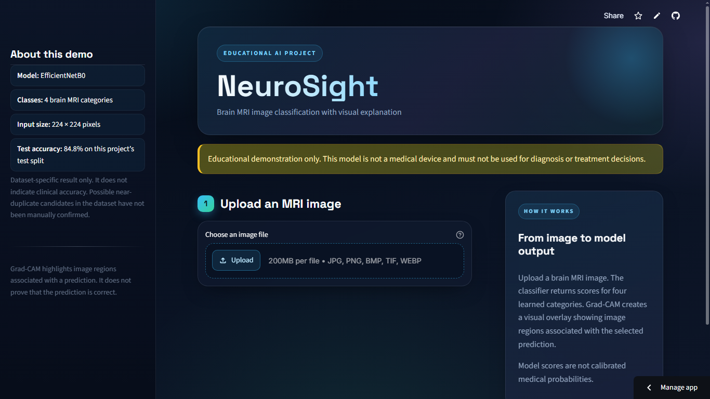
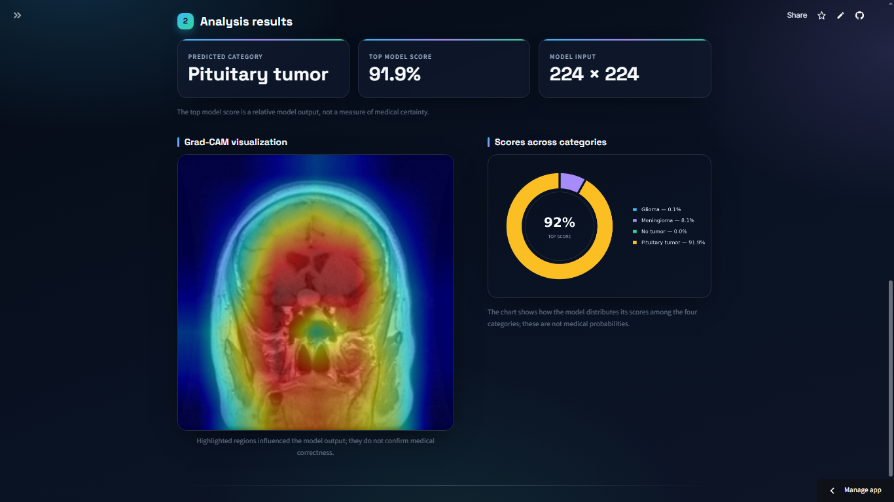

<div align="center">

# NeuroSight

### Brain MRI classification with EfficientNet-B0 and Grad-CAM

An educational computer-vision project that classifies brain MRI images into four dataset categories and visualizes image regions associated with a prediction.

[](https://www.python.org/)
[](https://pytorch.org/)
[](https://streamlit.io/)
[](https://docs.pytorch.org/vision/stable/models/generated/torchvision.models.efficientnet_b0.html)

[**Open the live demo**](https://brain-tumor-detection-dhbbpbvhrepegxl7u2ecjt.streamlit.app/)

</div>

> **Educational use only.** NeuroSight is not clinically validated, is not a medical device, and must not be used to diagnose or guide treatment.

## Demo




Upload an MRI image to view the model's predicted dataset class, the scores across all four classes, and a Grad-CAM visualization. Grad-CAM highlights regions associated with the model output; it is **not** a tumor outline and does not establish medical correctness.

## Project overview

NeuroSight is a four-class image-classification application built with transfer learning. It uses a pretrained EfficientNet-B0 backbone, replaces its original output layer with a four-class classifier, and serves predictions through a Streamlit web app.

The app resizes each uploaded image to 224 × 224 pixels, normalizes it using ImageNet channel statistics, and displays the model's relative class scores. These scores are not calibrated medical probabilities.

### Predicted categories

| Dataset label | Display label |
| --- | --- |
| `glioma` | Glioma |
| `meningioma` | Meningioma |
| `notumor` | No tumor |
| `pituitary` | Pituitary tumor |

## Technology stack

- **Python 3.13** — project language
- **PyTorch and Torchvision** — EfficientNet-B0 model, inference, and image preprocessing
- **ImageNet-pretrained EfficientNet-B0** — transfer-learning backbone
- **pytorch-grad-cam (`grad-cam`)** — Grad-CAM visualization
- **Streamlit** — interactive upload-and-predict web application
- **Pillow and NumPy** — image loading and array processing
- **Matplotlib** — score chart and confusion-matrix visualization
- **scikit-learn** — classification metrics and evaluation report
- **uv** — local Python environment and dependency management

## Model approach

1. Start from Torchvision's ImageNet-pretrained EfficientNet-B0 weights.
2. Replace the original 1,000-class output layer with a four-class classifier.
3. Train the classification head while keeping the pretrained feature extractor frozen for the initial model.
4. Compare model checkpoints using validation data, not the test set.
5. Generate a Grad-CAM map for the predicted class to show image regions associated with the output.

A later partial fine-tuning attempt did not improve validation accuracy, so the app uses the original baseline checkpoint at `models/efficientnet_b0_best.pth`.

## Evaluation

The project test split contains **1,600 images** (400 per class). The following are dataset-specific results from this project, not estimates of clinical performance.

| Metric | Result |
| --- | ---: |
| Validation accuracy | 92.2% |
| Test accuracy | 84.8% |
| Macro one-vs-rest ROC-AUC | 0.962 |
| Macro F1-score | 0.84 |

### Per-class test results

| Class | Precision | Recall | F1-score | Images |
| --- | ---: | ---: | ---: | ---: |
| Glioma | 0.93 | 0.66 | 0.77 | 400 |
| Meningioma | 0.72 | 0.81 | 0.76 | 400 |
| No tumor | 0.84 | 0.97 | 0.90 | 400 |
| Pituitary tumor | 0.94 | 0.95 | 0.94 | 400 |

Glioma recall is notably lower than the other class recalls, meaning a substantial portion of glioma images in this test set were missed. This is an important limitation, not something hidden by the overall accuracy.

The repository includes a confusion matrix and an example Grad-CAM image in `reports/`.

## Dataset

The project uses the [Brain Tumor MRI Dataset on Kaggle](https://www.kaggle.com/datasets/masoudnickparvar/brain-tumor-mri-dataset). The dataset page describes 7,200 images across glioma, meningioma, pituitary tumor, and no-tumor classes and lists a **CC BY 4.0** license. Please review the dataset page and its attribution terms before reuse.

The raw MRI folders are not stored in this repository. To run training or test-set evaluation, download the dataset separately and place it in this structure:

```text
brain-tumor-detection/
├── data/
│   ├── Training/
│   │   ├── glioma/
│   │   ├── meningioma/
│   │   ├── notumor/
│   │   └── pituitary/
│   ├── Testing/
│   │   ├── glioma/
│   │   ├── meningioma/
│   │   ├── notumor/
│   │   └── pituitary/
│   └── processed/
│       └── split_manifest.csv
```

The processed manifest records image paths, class labels, and split assignments. An image duplicate audit was performed while building the splits. Near-duplicate candidates were flagged, but not all were manually reviewed; this may affect the reported results.

## Run the app locally

The baseline checkpoint is included in `models/efficientnet_b0_best.pth`, so the app can run predictions without downloading the training dataset.

### Windows PowerShell

```powershell
git clone https://github.com/jayeshbaviskar345-ai/brain-tumor-detection.git
cd brain-tumor-detection
uv venv --python 3.13
.\.venv\Scripts\Activate.ps1
uv pip install -r requirements.txt
python -m streamlit run .\app\streamlit_app.py
```

Open the local URL printed by Streamlit in your browser.

### Run evaluation or fine-tuning

Training and evaluation scripts require the dataset folders above and the processed split manifest. The fine-tuning script starts from the included baseline checkpoint.

```powershell
python .\create_split_manifest.py
python .\train_efficientnet.py
python .\evaluate_model.py
python .\gradcam_demo.py
```

## Repository structure

```text
.
├── app/streamlit_app.py                 # Streamlit inference interface
├── data/processed/split_manifest.csv    # Image paths, labels, and splits
├── models/efficientnet_b0_best.pth      # Baseline four-class model
├── reports/                             # Confusion matrix and Grad-CAM example
├── audit_duplicates.py                  # Image duplicate audit
├── audit_manifest_duplicates.py         # Split-manifest duplicate audit
├── check_dataloader.py                  # Data-loader check
├── check_preprocessing.py               # Preprocessing check
├── create_split_manifest.py             # Train/validation/test manifest creation
├── evaluate_model.py                    # Test-set metrics and visualizations
├── gradcam_demo.py                      # Grad-CAM example generation
├── inspect_dataset.py                   # Dataset inspection
├── train_efficientnet.py                # Partial fine-tuning experiment
└── requirements.txt                     # Python dependencies
```

## Limitations and responsible use

- This is a learning and portfolio project, not a diagnostic product.
- The model can make incorrect predictions. Its scores are not calibrated probabilities.
- Grad-CAM is a visualization of model influence, not a tumor segmentation mask, clinical explanation, or proof of correctness.
- The dataset is a curated public collection; performance may not generalize to different hospitals, scanners, image protocols, or patient populations.
- The audit found near-duplicate candidates that have not all been manually confirmed. Treat the reported metrics cautiously.
- Do not upload identifiable patient images to the public demo.

## Acknowledgments

- Dataset: [Masoud Nickparvar, Brain Tumor MRI Dataset](https://www.kaggle.com/datasets/masoudnickparvar/brain-tumor-mri-dataset), listed under CC BY 4.0 on Kaggle.
- Pretrained model: [Torchvision EfficientNet-B0](https://docs.pytorch.org/vision/stable/models/generated/torchvision.models.efficientnet_b0.html), with ImageNet-pretrained weights.
- Explainability library: [pytorch-grad-cam](https://github.com/jacobgil/pytorch-grad-cam).
